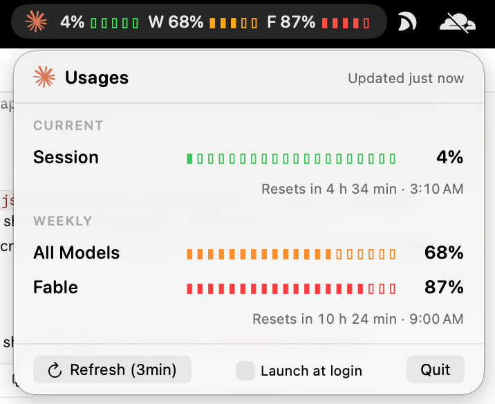

<p align="center">
  
</p>

<h1 align="center">ClaudeStatus</h1>

<p align="center">
  Your Claude usage limits, always one glance away in the macOS menu bar.
</p>

<p align="center">
  
  
  
  
</p>

<p align="center">
  
</p>

Claude's rate limits are invisible until you hit one. The usage page lives in a
browser tab, and by the time you open it the session is already locked. 
ClaudeStatus moves those three numbers into the menu bar, colour-coded and
refreshed every 15 minutes, so you can pace a long task, decide whether to
start another, or simply know when the window resets.

<p align="center">
  
</p>

## Highlights

- **Three limits, one line.** The 5-hour session window, the weekly all-models
  cap, and the separate weekly Fable cap, exactly as claude.ai reports them.
- **Colour tells the story.** Gauges turn from green to orange at 50 % and red
  at 80 %, so a glance is enough. No reading required.
- **Reset times you can plan around.** Live countdowns such as
  "Resets in 4 h 34 min · 3:10 AM" for each limit.
- **Zero maintenance.** Auto-refresh every 15 minutes, manual refresh on
  demand, launch at login with one checkbox.
- **Feels like part of macOS.** Menu bar only, no Dock icon, SF Rounded
  typography, adapts to light and dark menu bars.
- **Small enough to audit over coffee.** Three Swift files, no third-party
  code, no analytics, no network calls except the one that fetches your usage.

## Quick start

```bash
git clone <this repo> && cd ClaudeStatus
./build.sh run
```

Sign in the `claude` command-line tool once (`claude`, then `/login`), click
**Refresh (15min)**, and the gauges fill in. When you are happy, run
`./build.sh install` and tick **Launch at login** in the dropdown.

Full instructions, the Xcode route, and troubleshooting are in
**[SETUP.md](SETUP.md)**.

**Requirements:** macOS 13 Ventura or newer, Xcode Command Line Tools
(`xcode-select --install`), and a Claude subscription signed in through
[Claude Code](https://claude.com/claude-code).

## Reading the gauges

| Gauge | Source field                 | Meaning                             |
|-------|------------------------------|-------------------------------------|
| first | `five_hour`                  | Current 5-hour session window       |
| **W** | `seven_day`                  | Weekly limit across all models      |
| **F** | `limits[kind=weekly_scoped]` | Weekly limit for Fable specifically |

Each ▮ in the menu bar represents 20 %; each ▮ in the dropdown represents 5 %.
A ⚠︎ after the gauges means the last refresh failed and the numbers shown are
the previous ones. Open the dropdown for the reason and a one-click fix.

## How it works

1. `Service.swift` loads the OAuth token that the `claude` CLI stored, either
   from `~/.claude/.credentials.json` or from the login Keychain item
   `Claude Code-credentials`. The Keychain item is read with the same
   `/usr/bin/security` tool Claude Code writes it with, so macOS shows no
   permission dialog. If the file copy has expired and the Keychain has a
   fresh one, the Keychain wins.
2. It calls `GET https://api.anthropic.com/api/oauth/usage` with that token and
   the `anthropic-beta: oauth-2025-04-20` header, then decodes the response
   generically so new or renamed limits still appear.
3. `Views.swift` renders the menu bar label as a single AppKit image (the only
   way to keep per-gauge colour in a `MenuBarExtra`) and draws the dropdown in
   SwiftUI.
4. A background task repeats step 2 every 15 minutes; the dropdown's
   countdowns tick independently every 30 seconds.

The token lives in memory for the duration of a request and is never written
to disk, logged, or sent anywhere else. The only file the app creates is
`~/Library/Caches/ClaudeStatus/last-usage.json`, the last raw response
(percentages and reset times, no credentials), kept for troubleshooting.

## Design principles

- **Glanceable first.** The menu bar label is the product; the dropdown is the
  detail view. Nothing in the label should need reading twice.
- **Native over clever.** System fonts, system colours, system controls,
  system login-item API. It should look like Apple shipped it.
- **Honest about failure.** Every error names its cause and offers the fix,
  from "not signed in" to "endpoint changed".
- **No surprises with your credentials.** One token source, one endpoint, code
  short enough to verify that claim yourself.

## Roadmap and ideas

Contributions toward any of these are welcome:

- Notification when a limit crosses 80 % or 100 %, and when it resets.
- Compact mode showing only the highest gauge for narrow menu bars.
- Hover tooltips on each gauge in the menu bar.
- Extra-usage (pay-as-you-go) balance when the account has it enabled.
- Homebrew cask and a notarised release build.
- Shortcuts and AppleScript actions to read usage from automations.

## FAQ

**Does it work with Claude Desktop alone?**  
No. Claude Desktop keeps its login private to its own process. The `claude`
CLI must be signed in once; the dropdown's **Sign in via Terminal** button
opens it for you. Both use the same account, so the numbers match.

**Why does macOS ask for Keychain access?**  
Normally it doesn't: the app reads the item through `/usr/bin/security`,
which is already allowed. The dialog only appears if that path fails and the
app falls back to the Security framework; there the grant is tied to the
exact ad-hoc signature, so a rebuilt app asks again. If you ever clicked
**Deny**, the dropdown now says so ("macOS refused access …") instead of
"Not signed in", and tells you how to fix it in Keychain Access.

**It says "Claude Code is signed out" although I use Claude every day.**  
Claude Desktop's Code tab signs in with its own token and does not store it
for other apps; the entry the `claude` command-line tool keeps in the login
Keychain can still be empty (after `/logout`, or when a token refresh failed).
Run `claude` in Terminal, type `/login`, finish in the browser, then click
**Refresh (15min)**.

**Where can I see why the last refresh failed?**  
`~/Library/Caches/ClaudeStatus/last-error.txt` holds the last error message
(never the token) and is deleted on the next successful fetch;
`last-usage.json` next to it is the last successful response.

**`./build.sh install` says "Permission denied" on /Applications.**  
Your account is not an administrator. The script then installs to
`~/Applications` instead, which needs no extra rights and works with
launch-at-login.

**Can I redistribute the built app?**  
Not as-is. Ad-hoc signed apps are blocked by Gatekeeper on other Macs. Point
people at `./build.sh run`, or notarise your own build.

**What happens if Anthropic changes the endpoint?**  
The gauges show a clear "Unexpected response format" error. Compare the cached
response with `UsageAPI.parse` in `Service.swift`; the decoder is written to be
easy to adjust.

## Contributing

Issues and pull requests are welcome. The whole app is `App.swift`,
`Service.swift` and `Views.swift`; `./build.sh run` rebuilds and relaunches in
a few seconds. Please keep the dependency count at zero.

## Disclaimer

This is an independent, unofficial project. It is not affiliated with,
endorsed by, or supported by Anthropic. The usage endpoint it reads is
undocumented and may change without notice. "Claude" and the Claude spark mark
are trademarks of Anthropic, PBC; the icon in `assets/` identifies the service
the app reads from and remains Anthropic's property.
